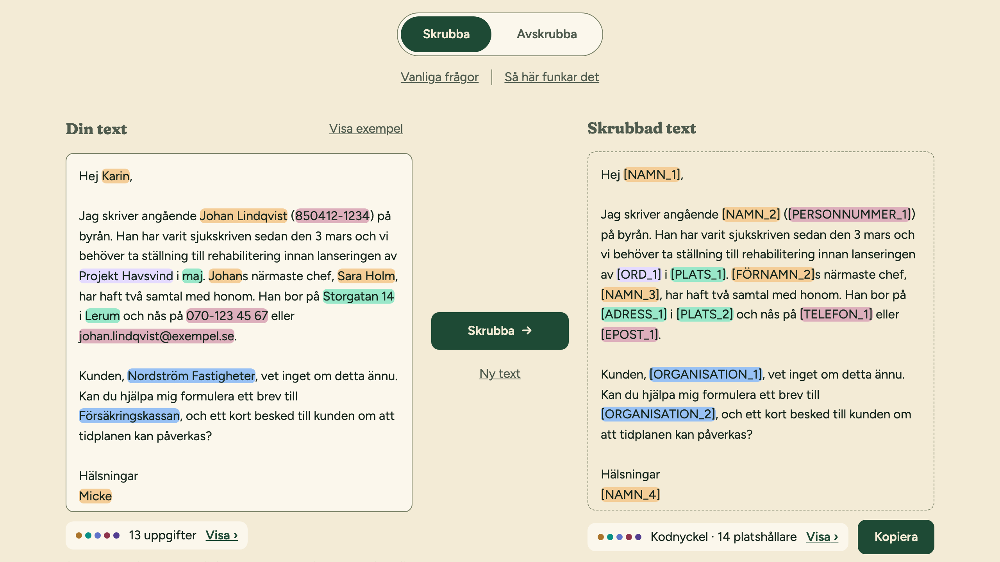

<p align="center">
  <picture>
    <source media="(prefers-color-scheme: dark)" srcset="design/logo/skrubba-logotyp-negativ.svg">
    
  </picture>
</p>

<p align="center">
  <strong>Hide personal data in Swedish text before you paste it into an AI, and put it back in the answer.</strong><br>
  Runs entirely in your browser. Nothing you write leaves your computer.
</p>

<p align="center">
  <a href="https://skrubba.promptagency.se">skrubba.promptagency.se</a>
</p>

<picture>
  <source media="(prefers-color-scheme: dark)" srcset="docs/images/skrubba-dark.png">
  
</picture>

## What it does

You want help from ChatGPT, Claude or Copilot with a text about a real person: an employee, a client, a patient. Pasting it as it is sends their name, personnummer and address to someone else's server.

Skrubba swaps those details for placeholders first:

> Jag skriver angående **Johan Lindqvist** (**850412-1234**) …
> → Jag skriver angående **[NAMN_2]** (**[PERSONNUMMER_1]**) …

You paste the scrubbed text into the AI. When the answer comes back, you paste it into Skrubba, which puts the real names and numbers back where the placeholders are.

It is free and open source, and it is made for anyone who handles other people's details or confidential material: HR, recruiters, finance, customer service, agencies and consultants.

## How to use it

1. **Paste your text** in the left box. Names, numbers, addresses and companies are highlighted as Skrubba finds them.
2. **Check the highlights.** Click one to keep that word as it is. Select a word that was missed to hide it too. Add words to *Egna ord*, such as client or project names, to hide them every time.
3. **Press Skrubba** and copy the result into any AI tool.
4. **Switch to Avskrubba**, paste the AI's answer and press Avskrubba. The real details are back.

The *kodnyckel* (key) lists which placeholder stands for what. It exists only in the open browser tab. Download it if you want to continue in another session, and store that file as carefully as the original text, since it contains the real details.

## What it finds

- **With a Swedish language model:** names, places and organisations, including ones it has never seen.
- **With rules:** personnummer, samordningsnummer, organisationsnummer and VAT numbers, company names followed by AB, HB, Ltd and the like, phone numbers, email addresses, web addresses (also without https://), street addresses, postcodes, apartment numbers, bank and plusgiro, IBAN, card and account numbers, IP addresses, journal numbers and car registration numbers.
- **From you:** your own word list, plus anything you select by hand.

When in doubt it hides too much rather than too little. You can keep a word with one click, but a detail that slips through is gone.

## Privacy

Nothing you type is sent anywhere. The language model is downloaded once from the same site and then runs on your own computer. After that the app also works offline.

- No cookies, and no fonts or scripts from other sites.
- Visits are counted anonymously: on page load, one page view (the address, where you came from) goes to Skrubba's own address, which passes it on to Prompt Agency's self-hosted [Plausible](https://plausible.io) in Finland. Plausible sets no cookies and stores no IP address. Do Not Track and Global Privacy Control are respected. What you type is never part of it.
- Your text, the word list and the kodnyckel are kept in memory only. Closing the tab erases them.
- A strict Content Security Policy stops the page from connecting to any other server, even by mistake.

**Check it yourself.** Open your browser's developer tools (F12), go to the *Network* tab and use Skrubba. Every request goes to Skrubba's own address, and none happens when you press Skrubba or Avskrubba. The only one that is not part of the page itself is the visit count (`/api/event`) when the page loads. Or load the page, turn off wifi, and see that everything still works.

## What it is not

Skrubba is a tool that helps you share less, not a guarantee that a text is anonymous.

- It can miss things, especially unusual names, and details that identify someone without being a name or number, such as "the only female manager in Lerum". Read the scrubbed text before you copy it.
- It does not make you compliant with GDPR or your employer's AI policy. Follow your organisation's rules.
- It only works on Swedish text.

## Run it locally

You need [Node.js](https://nodejs.org) 22 or later.

```sh
npm install
npm run dev        # http://localhost:5173
```

The first `dev` or `build` downloads the language model (about 60 MB) from Hugging Face into the project, checks it against pinned sha256 hashes, and packs it for serving. After that, nothing is fetched again.

```sh
npm run build      # static site in dist/, ready for any static host
npm run preview    # serve the build at http://localhost:4173
```

### Tests

```sh
npm test                    # unit tests (Vitest), including runs against the real model
npx playwright install      # once, to get the test browsers
npm run e2e                 # browser tests in Chromium, Firefox and WebKit
```

The browser tests include the privacy checks: `no-egress.spec.ts` records every request during a full session and fails if any goes to another origin, and `restore.spec.ts` fails if anything is written to localStorage, sessionStorage, IndexedDB or cookies.

## How it is built

A static site: Vite, React and TypeScript, no backend. The masking engine is [maskera](https://github.com/joelhagvall/maskera), wrapped behind a small interface in `src/engine/`. The model runs in a Web Worker with ONNX Runtime (WebAssembly), so the page never freezes. A service worker caches the app and the model for offline use.

More detail in `docs/`:

- [ARCHITECTURE.md](docs/ARCHITECTURE.md): modules, how detections are merged and numbered, how restoring tolerates an AI that changes the placeholders, the privacy constraints.
- [UX.md](docs/UX.md): the screen, its states and keyboard shortcuts.
- [DEPLOY.md](docs/DEPLOY.md): deploys, the offline cache and its kill switch.
- [COPY.md](docs/COPY.md): every Swedish string in the interface, and the tone.
- [design/DESIGN.md](design/DESIGN.md): the visual identity and design tokens.

## Credits

- [maskera](https://github.com/joelhagvall/maskera) by Hägvall Labs (MIT): the Swedish masking rules and the NER model.
- [KB-BERT](https://huggingface.co/KBLab) by KBLab at the National Library of Sweden (CC0): the language model maskera's NER is trained from.
- [Transformers.js](https://github.com/huggingface/transformers.js) and [ONNX Runtime Web](https://onnxruntime.ai): running the model in the browser.

Made by [Prompt Agency](https://promptagency.se).

## License

[MIT](LICENSE)
